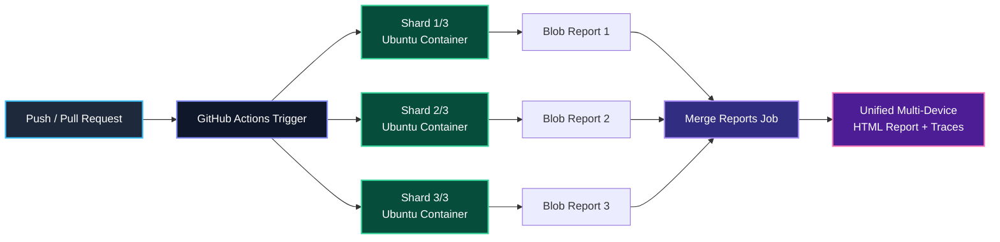

# Playwright Enterprise CI/CD Framework 🚀

An advanced, production-ready Test Automation Framework built with **Playwright** and **TypeScript**. This project demonstrates modern Quality Engineering practices required for fast-paced, high-scale national and international environments, focusing on performance optimization, API mocking, and robust CI/CD integration.

---

## 🎯 Key Architectural Features

*   **Global Authentication Setup (`storageState`):** Simulates a single-login workflow executed once during the initialization phase, storing credentials globally to skip UI login forms on subsequent tests.
*   **Custom Reusable Fixtures:** Built-in isolation using extended Playwright fixtures (`authenticatedPage`) instead of traditional, flaky `beforeEach` hooks.
*   **Hybrid Testing (API + UI):** Seeds required data using Playwright's native `request` client before executing UI validation, cutting execution time.
*   **Network Interception & Mocking:** Intercepts API network traffic via `page.route` to simulate edge cases and resilient UX behaviors (e.g., handling `HTTP 500` server errors gracefully).
*   **Visual Regression Testing:** Snapshot comparison assertions to prevent unexpected UI layout shifts.

---

## 🛠️ Tech Stack & Tools

*   **Language:** TypeScript (Node.js v20+)
*   **Test Runner:** Playwright (Latest 2026 Stable)
*   **CI/CD Engine:** GitHub Actions
*   **Test Report:** Native Blob Reporter merged into a single multi-device HTML Report.
*   **Target Application:** [Automation Exercise](https://automationexercise.com/)

---

## ⚡ Scalable CI/CD Pipeline (Sharding Strategy)

To minimize execution time and compute costs, the GitHub Actions workflow runs tests using **Sharding**. 


The pipeline splits the test suite across **3 concurrent containers**, lowering execution time by up to 60%. If a test fails, screenshots, videos, and full network **Trace Viewer** logs are preserved and attached to the run.




---

## 📂 Project Structure

```text
├── .github/
│   └── workflows/
│       └── playwright.yml       # Optimized Multi-job Sharded CI Pipeline
├── tests/
│   ├── auth/
│   │   └── global.setup.ts      # One-time Session Storage Setup
│   ├── e2e/
│   │   ├── checkout.spec.ts     # E2E flows with API Mocking & Error Handling
│   │   └── catalog.spec.ts      # Hybrid UI/API data validation
├── fixtures/
│   └── basePage.ts              # Custom Extended Playwright Fixtures
├── page-objects/
│   ├── CartPage.ts              # Page Object Model (POM) Design Pattern
│   └── LoginPage.ts
├── playwright.config.ts         # Multi-browser & Reporter Configuration
└── README.md
```

---

## 🚀 Getting Started

### Prerequisites
Make sure you have [Node.js v20+](https://nodejs.org) installed on your machine.

### Installation
1. Clone this repository:
   ```bash
   git clone https://github.com/Aitalucas/playwright-ecommerce
   cd playwright-ecommerce
   ```
2. Install project dependencies:
   ```bash
   npm ci
   ```
3. Install required Playwright browser binaries:
   ```bash
   npx playwright install --with-deps
   ```

### Running Tests Locally

*   **Run all tests (Headless mode):**
    ```bash
    npx playwright test
    ```
*   **Run tests with UI Mode (Interactive Debugging):**
    ```bash
    npx playwright test --ui
    ```
*   **Generate and View HTML Report:**
    ```bash
    npx playwright show-report
    ```

---

## 🧠 Author

*   **Lucas Bittencourt** - QA / Quality Engineer
*   LinkedIn: [Lucas Bittencourt](https://linkedin.com/in/lucas-teixeira-aita-bittencourt/)
*   Email: [aita.lucas@hotmail.com](mailto:aita.lucas@hotmail.com)

